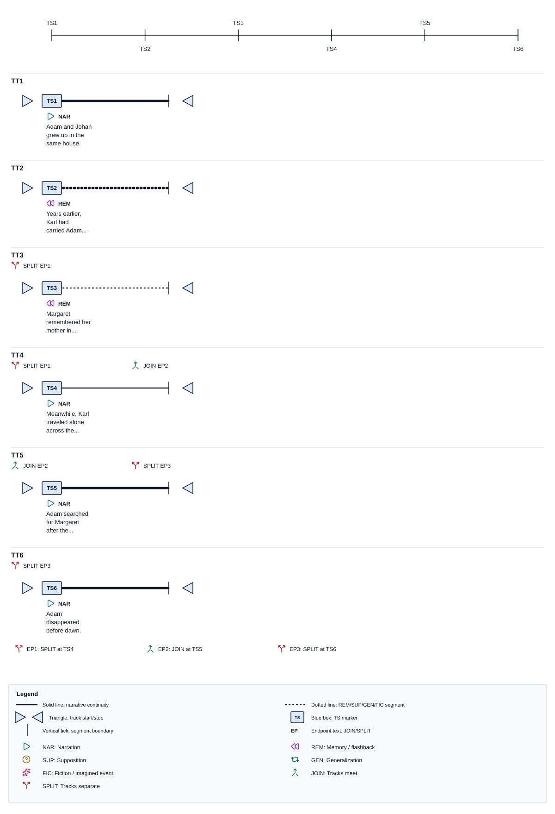

# TYM .NET API Prototype

TYM is a small ASP.NET Core Minimal API for turning narrative text into time-yard diagrams. It is based on the time-yard model from Cristea and Macovei: a text is represented as time tracks (`TT`), time segments (`TS`), endpoints, and temporal relations. The generated SVG mirrors the example image by showing:

- a text-order segment chain, where `TS` items appear in reading order
- a time-yard view, where segments are arranged by narrative tracks
- start/stop markers, joins/splits, rupture/commute hints, and segment labels

This prototype now follows the implementation directions from the supplied papers more closely. It first extracts event-like clauses, attaches actors, temporal anchors, locations, actions, and a `Past`/`Present`/`Future` temporal category, then groups contiguous compatible events into time segments. ML.NET is used for event temporal-category classification and for each candidate time segment's narrative type (`NAR`, `REM`, `SUP`, `GEN`, or `FIC`). The bundled models are trained at startup from seed examples in `Program.cs`; a production implementation should replace those examples with the annotated TYM corpus.

No LLM is used by the API pipeline. Event/temporal extraction uses rules plus ML.NET classifiers; entity highlighting additionally uses local trained spaCy NER and POS models. The renderer is deterministic JSON/SVG/XML generation. The JSON/XML output now also includes a TimeML-style layer with `EVENT`, `TIMEX3`, `SIGNAL`, `MAKEINSTANCE`, and `TLINK` annotations so the TYM diagram can be compared with standard temporal NLP tooling. Each response also includes an `analysis` object with extractor counts, confidence averages, classifier sources, distribution statistics, and quality issues.

English is the default extraction language. Romanian narrative text is supported with `options.language = "ro"` using Romanian rule profiles for named-entity candidates, temporal anchors, temporal signals, event tense, TimeML-style labels, and TYM segment/track creation.

### Selectable AI Segmentation

The v0.9 workbench uses **Temporal segmentation algorithm**: temporal continuity rules
(default), ML.NET logistic regression, or ML.NET averaged perceptron. The learned
algorithms decide temporal-development boundaries in English and Romanian using
small authored temporal-feature seeds, not a validated narrative corpus. A TS
can span many sentences/paragraphs; changing names, locations or punctuation alone
does not create a TS. Explicit time/development shifts delimit contexts; ML may
classify weaker tense candidates. Set
`options.segmentation_algorithm` to `article_rules`, `mlnet_logistic`, or
`mlnet_perceptron`. Sentence/clause event extraction is a lower-level stage, not
temporal segmentation. TS type labeling remains a separate classifier.

The **Segmentation** view marks original source with TS IDs, type colors and a
legend, exact UTF-16 ranges, boundary features and model scores. Segments are
paged without truncation, and a TT arrow opens the matching track. Changing the
algorithm clears incompatible density caches; changing TT density preserves the
segmentation. See [implementation, API and verification](docs/segmentation-classifiers.md).
The v0.9 correction is published on [the live workbench](https://tymui20260707serban.z13.web.core.windows.net/). See the
[23 October changes document](docs/research/TYM_Temporal_Segmentation_Changes_20261023.md)
for behavior, verification and remaining paper-model limitations.
The [PDF report](https://tymui20260707serban.z13.web.core.windows.net/research/TYM_Temporal_Segmentation_Changes_20261023.pdf)
is also published on the live site.

### Offline Caching

Both live workbench hosts support [offline and database caching](docs/offline-caching.md):
saved diagrams and library metadata in IndexedDB, an offline application shell,
and an optional bounded SQLite API cache. Browser caching is active; the deployed
API database cache remains disabled until private persistent storage is configured.
The Saved diagrams and Cached TT density controls share a responsive horizontal
row. See the [23 October release checks](docs/verification/offline-20261023.md).

The [23 October improvement roadmap](docs/research/TYM_Improvements_20261023.md)
and [PDF](output/pdf/TYM_Improvements_20261023.pdf) separate implemented work,
release prerequisites and proposed research improvements.

## Example

Input text:

> Adam and Johan grew up in the same house. Years earlier, Karl had carried Adam through the rain. Margaret remembered her mother in Jakarta. Meanwhile, Karl traveled alone across the island. Adam searched for Margaret after the storm. Margaret found Adam at the doorway. Adam disappeared before dawn.

Generated diagram:



The generated SVG includes a legend for solid lines, dotted lines, track start/stop triangles, segment boxes, boundary ticks, and inferred JOIN/SPLIT endpoint labels.

### Diagram readability and tag icons

Time tracks display their identifiers only (for example, `TT1`), without generated titles. Long tracks continue on new rows rather than shrinking markers/labels into the available width. Segment descriptions wrap across up to three lines; SVG tooltips retain their full text. Track identifiers, endpoint badges, mode labels, and segment markers occupy separate vertical bands. The text-order strip samples evenly spaced IDs on large inputs, including the first and last, while the time-yard SVG retains every segment.

The viewer places **Time segments (TS)** in a separate overview above **Time tracks (TT)**. Each has its own scroll container. TT paging, filtering, grouping and zoom do not move, hide or duplicate the TS row. The TS overview stays at native size with horizontal scrolling; SVG exports retain the complete combined diagram and legend.

The viewer opens at 100% with scrolling and filters by track ID or character name. **Display groups** offers 0-10: **0** keeps twelve tracks per page; **1-10** partitions the total tracks into that many balanced, contiguous displays. Impossible group counts are disabled when there are fewer tracks. A group selector, track ranges, and previous/next controls navigate the displays. Search finds matching tracks across all groups while preserving their original group boundaries. Paging, grouping, and filtering use the existing SVG without another analysis request. Fit, zoom in/out, and actual-size controls remain available. SVG downloads contain all tracks; the displayed group/page is only a navigation view.

The UI uses the supplied DataSpace visual system: charcoal surfaces, emerald/mint accents, a 64-pixel grid, restrained 3-pixel controls, and self-hosted Space Grotesk, Inter, and IBM Plex Mono fonts with Romanian support. Dark is the default; the header theme button toggles the matching light palette and stores only the theme preference locally. The on-screen SVG follows the selected theme; downloaded SVGs keep their original self-contained print colors. No DataSpace biography, contact form, or CV is copied into TYM.

**Highlight entity** is a select menu populated by `POST /v1/entities` for the exact current text/chapter and extraction language. Trained English/Romanian spaCy NER supplies people, places and organizations. Complete model spans with a nominal token are preserved, including internal articles/prepositions in names such as "Bank of England". Uncovered `PROPN` candidates retain an explicitly identified rule fallback; other model spans, including dates/numbers, never become fallback name fragments. Ordinary common nouns and function words are not standalone candidates. People/places can include resolved reference forms such as `he`, `his`, `el`, or `ea`. A separate **Unresolved references** group permits literal nonpossessive `PRON` highlighting. Lookup is debounced by 600 ms; stale requests are canceled when the text, chapter, language or API URL changes. The refresh icon retries failed lookup. Responses expose UTF-16 spans, actual POS, `recognition_source`, original `model_label`, `ner` model/component/count metadata and method `spacy-trained-ner+pos+rule-anaphora-en-ro-v4`. See [trained NER behavior and limitations](docs/trained-ner.md).

The anaphora baseline uses a two-sentence active context, unambiguous recent antecedents, local reflexives, adjacent relative pronouns, explicit coordinated groups, and place references (`here`/`there`, `aici`/`acolo`). Grammatical-gender evidence comes from resolved pronouns, not a guessed gender dictionary of names. First/second-person, unsupported neuter/demonstrative, ambiguous, and quoted references remain unresolved. There is no LLM, pretrained coreference model, or full syntactic/discourse parser. These are conservative heuristics, not measured coreference accuracy. This feature affects the highlight picker and highlight spans only: it does not rewrite actor extraction, track grouping, narrative events or TimeML. Named-entity highlighting uses actual explicit/resolved source spans instead of assuming every inherited actor mention is correct.

Entity lookup accepts up to 2,000,000 UTF-16 code units and uses a separate 30-requests/minute/IP limit. It does not consume the five daily diagram generations. Like diagram generation, it sends the current text to the selected API URL. HTTP responses use `no-store`; neither text nor entity lists are stored in browser storage. The API caches at most eight POS results (bounded by 2,000,000 input code units) in process memory. Tagging is local to the API host; no LLM/cloud NLP service receives text. Missing models/runtime return HTTP `503`, with no unfiltered fallback. POS errors can still omit names or retain mistagged words, especially literary/OCR text and homographs; this is not measured NER/coreference accuracy. See [POS setup and limitations](docs/plans/pos-filtering.md).

### Track titles and density

TT names in JSON/XML remain short extractive summaries of their events, but are not displayed in SVG diagrams or TT tooltips. A deterministic, bilingual stopword-filtered term-frequency scorer selects a representative event, then limits the title to twelve words and at most 99 characters. It does not call an LLM or an external service. Titles are baseline summaries, not validated semantic annotations; actor-based search and highlighting still use the underlying segment actors.

The UI's **TT density** slider sets `options.track_density` (integer 0-100, default 50). **0** gives an overview by coarsening actor/perspective tracks within the same narrative mode (main, memory, parallel) and temporal category. **50** preserves the original actor/perspective/temporal grouping. **100** creates one TT per temporal segment. Intermediate values deterministically refine these groups; discrete inputs can produce plateaus. Every event, segment, source span, and TimeML annotation remains available at every density. Track-level boundaries, relations, and endpoints are recomputed for the chosen grouping. Low-density overviews are not claims that different characters share one development.

`track_generation` in the response records the effective density and `extractive-event-summary-v1` title method. Change the slider and generate again to apply it. A matching saved density avoids another request; actual API generation requests use the normal daily quota.

The UI offers densities **10, 20, 30, 40, 50, 60, 70, 80, 90 and 100**. It displays the selected density first, then caches other layouts sequentially in the background from the same NLP analysis. **Cached TT density** switches ready diagrams without another daily usage. Background progress never changes the selected diagram. Input or resolution changes abort warming and clear the active result; late responses are ignored. A failed/expired background session leaves the current diagram usable. Completed layouts are also saved in bounded IndexedDB storage for offline reopening. Partial bundles advertise only completed views; IP-bound warming sessions are never persisted.

**Diagram width** follows the current browser window width in CSS pixels, within the SVG renderer's 720-2400 pixel bounds. The current window width and height are shown beneath it. Cached diagrams belong only to that exact window resolution: any width or height change clears the active view, including changes within the mobile width clamp. Saved diagrams lists only records matching the current API and resolution, so returning to an earlier size makes its saved results available to reopen explicitly. Responses generated for a previous resolution are ignored. Resizing never starts generation or consumes another daily usage automatically.

The UI sends `options.progressive_density_cache = true`: the primary response contains only the selected view and an IP-bound density session. Background `GET /v1/density-sessions/{id}/{density}` calls reuse its extracted events, classification and TimeML rather than rerunning NLP or spending daily permits. Sessions are memory-bounded and expire after ten idle minutes; layout requests have a separate 60/minute/IP limit. `density_cache.options` maps ready presets to `base` or an entry in `density_cache.views`. Alternate views contain placements/topology rather than duplicate source events. Legacy API clients can still request synchronous layouts with `cache_track_densities = true`. Responses use compression and `no-store`.

The self-contained SVG embeds seven icons and a labeled legend: play for `NAR`, rewind for `REM`, question mark for `SUP`, repeat for `GEN`, sparkles for `FIC`, merge for `JOIN`, and split for `SPLIT`. Color supplements the shapes and text labels. `GEN`, like `REM`/`SUP`/`FIC`, uses the legend's dotted segment line. Icons require no external font or CDN; licensing notices are retained in the SVG metadata and [third-party notices](THIRD_PARTY_NOTICES.md).

SVG numeric coordinates use invariant formatting regardless of server locale. Invalid XML control characters from PDF text are normalized only in displayed labels/tooltips, preserving the original input and analysis offsets. See [rendering verification](docs/plans/rendering-verification.md) for tested widths, locales, and full-book counts.

### Local literary example

The user-supplied Romanian Tash Aw PDF and fifteen text files are available as sixteen complete inputs, with a separate local excerpt for each. The PDF's full input contains extraction from all 352 pages. Sources, extraction choices, work/translation/volume groups, and API request fixtures are documented in [the example guide](docs/plans/examples.md). Original books, extracted prose, and previews remain excluded from Git and ordinary publishing/Docker contexts. A separately prepared server-only library can be deployed explicitly as described below.

Chapter detection recognizes line-start `Capitolul`, `Capitol`, and `Chapter` headings with Arabic/Roman numerals, digit ordinals (`21st`, `al 2-lea`), and Romanian/English spelled-out cardinal or ordinal numbers (`UNU`, `DOI`, `TREI`, `PATRU`, `ONE`, `TWO`, `THREE`, `FOUR`, `al doilea`, `Twenty-First`). Matching ignores case and number-word diacritics while preserving original source spelling and offsets. Original/repeated numbering, front matter, whitespace, and the complete final chapter are preserved. The selector and previous/next controls submit the exact selected chapter.

**Chapter detection** has three modes. **Auto** also accepts standalone consecutive numeral/number-word sequences with at least three headings and at least 500 UTF-16 units between headings; bare numbering is disabled for text containing PDF form feeds to avoid treating page folios as chapters. **Prefixed headings only** disables those heuristics. **Include short numbered sections** explicitly permits two-or-more consecutive standalone headings in short inputs/excerpts, including PDF text; inspect the resulting ranges because page numbers/lists can then be mistaken for chapters. This is structural detection, not validated chapter annotation. Chapter mode works on whichever full text or excerpt is currently loaded and never silently substitutes the full book for an excerpt. Pasted text is supported too. Returned event/TimeML spans are chapter-local; add the separately displayed source start offset to map them to the complete input. Independent chapter analysis does not infer cross-chapter coreference or temporal links.

In a Development UI process accessed over loopback, an existing `private-examples/examples.json` adds a book selector with source attribution, full-text/excerpt controls, and the loaded character count. Complete text loads on demand through a local-only endpoint. Preview pictures are explicitly tied to excerpts. Production and remote requests do not receive the private catalog or full texts. `TYM_PRIVATE_EXAMPLES_FILE` can override the catalog path. The original English and Romanian demos remain available without private files.

### Hosted Book Library

**Book library** makes the existing sixteen complete inputs available for analysis without sign-in. The source files live only in the API's private container image, outside any static website directory. `GET /v1/books` returns metadata and chapter/section choices, not book contents. The UI submits a book ID and optional section ID to `POST /v1/books/{id}/diagrams` or `POST /v1/books/{id}/entities`; book language is fixed by the catalog. Entity recognition is explicitly requested with the refresh button rather than running for every selected chapter. Book generation shares the existing five-per-IP daily quota; entity lookup shares the separate thirty-per-minute quota.

**For now, all user types can read hosted chapter/section and full texts, including guests.** Set `TYM_REQUIRE_LOGIN_FOR_TEXT=true` to restore confirmed-account-only reading. Chapter labels use Arabic numbers such as **Capitolul 1** without changing original headings or offsets. The read-only source endpoint retains its reading quota and `no-store` response policy. Book mode still has no source-text editor, copy command, JSON/XML export or raw JSON/XML view. **This is not DRM:** displayed/public source text can be copied using browser tools. Only deploy books you are authorized to make available.

### Google and Email Sign-In

Email registration/login, confirmation, password recovery and direct Google Identity Services are implemented using ASP.NET Core Identity, **without Firebase**. Accounts are disabled until configured. Google needs a Web OAuth client ID and authorized UI origins; email needs a working SMTP sender. Local development uses SQLite; Azure SQL support uses managed identity and keeps account records and Data Protection keys in the private database. The approved free-limit Azure database is blocked by Azure SQL regional provisioning restrictions, so live accounts remain disabled pending region access and delivery verification. See [account configuration](docs/accounts.md). Local browser tests use a private mail-pickup directory; they do not establish real Google sign-in or SMTP delivery.

The research improvement proposal is available as [editable Markdown](docs/research/TYM_Research_Improvement_Proposal.md) and [PDF](output/pdf/TYM_Research_Improvement_Proposal.pdf), with a source audit, non-LLM architecture, evaluation design and prioritised roadmap.

The [20 October improvement audit](docs/research/TYM_Improvement_Audit_20261020.md), also available as [PDF](output/pdf/TYM_Improvement_Audit_20261020.pdf), adds a reproducible density/semantics diagnostic, verified NLP-framework capabilities, the .NET support deadline and concrete acceptance criteria. A dated addendum distinguishes the subsequently enabled trained NER from the remaining proposals; no new research accuracy result is claimed.

### Book Preparation

Preparation verifies the original UTF-8 SHA-256 and UTF-16 length, then writes separate cleaned copies: LF line endings, no BOM or paragraph indentation, trailing whitespace removed, at most one blank separator line, and a final newline. Plain-text prose uses blank-line paragraph separation rather than code-style indentation. Words, diacritics, punctuation, hyphens and intentional single line breaks are unchanged. There is no spelling correction, dehyphenation or OCR. Originals are never overwritten. Chapter offsets apply to the **cleaned** edition, not the original file.

Every cleaned character belongs to a chapter/reading section. The prepared catalog retains convenient paragraph-bounded reading sections for long unmarked inputs. **Full text** analyzes any complete hosted book without the former 100,000-character restriction or truncation. Chapter processing remains optional and independent. Book mode omits the internal source-status/filename block and XML payloads; text copy/download controls remain absent. The selected diagram is returned first; other density layouts are built in the background rather than holding up full-book results.

```powershell
node tools/prepare-book-library.cjs private-examples build_publish/my-library/library
$env:TYM_LIBRARY_PATH = "$PWD/build_publish/my-library/library"
dotnet run
```

Use a new output directory for each preparation. The generated catalog and all source files are ignored. For explicit Azure deployment, build the ordinary API image from its public-only context, then use [the library image layer](deploy/Dockerfile.library) in a separate ignored context containing only that Dockerfile and `library/`. Keep the registry private. Never upload `library/` to `$web` or commit it. An unconfigured API returns an empty book list.

The workbench includes four self-hosted, credited example images: Jakarta, a Jules Verne portrait, the 1871 *Twenty Thousand Leagues* frontispiece, and an 1843 *Christmas Carol* cover. Historic images are not presented as covers of the supplied Romanian editions. See [image sources and licenses](THIRD_PARTY_NOTICES.md#workbench-example-images).

### Improvement plans

The [two-prototype roadmap](docs/plans/README.md) separates the [diagram API plan](docs/plans/diagram-api.md) from the [ML.NET Corpus Explorer plan](docs/plans/corpus-explorer.md). The second plan references the separately reviewed corpus project; this checkout does not contain that application. Planned work, recorded software checks, and research accuracy are explicitly separated.

## Minimal React UI

The workbench supports independent **English / Română flag buttons** for the interface, including analysis views, account dialogs, chapter labels and SVG legends. The labeled buttons show the active language and support keyboard activation; there is no interface-language dropdown. The remembered preference does not change the text's analysis language or invalidate cached diagrams. See [internationalization and verification](docs/internationalization.md). The bilingual interface and trained entity picker were published to both Azure UI hosts on 20 October 2026; the [release record](docs/verification/i18n-ner-20261020.md) separates deployed features, regression checks and account-activation blockers.

Live UI:

[https://tymui20260707serban.z13.web.core.windows.net](https://tymui20260707serban.z13.web.core.windows.net)

Container App UI:

[https://tym-ui-serban.livelyrock-2726c024.eastus.azurecontainerapps.io](https://tym-ui-serban.livelyrock-2726c024.eastus.azurecontainerapps.io)

Live API:

[https://tym-api-serban.livelyrock-2726c024.eastus.azurecontainerapps.io](https://tym-api-serban.livelyrock-2726c024.eastus.azurecontainerapps.io)

The UI is in [ui/Tym.Ui](ui/Tym.Ui). It serves a minimal React page with English and Romanian examples, calls `POST /v1/diagrams`, displays extraction counts, renders the returned SVG, supports fit/zoom inspection, exposes Analysis/TimeML/JSON/XML result tabs, and can download SVG/JSON/XML outputs.

## Run

For the POS-filtered entity picker and entity highlighting, install Python 3.11 or 3.12 and configure the local models once (downloads packages/models; not user texts):

```powershell
.\tools\setup-pos.ps1 -Python python
```

Then start the API from the repository root:

```powershell
cd tym-api
dotnet run --urls http://127.0.0.1:8765
```

Then call:

```powershell
Invoke-RestMethod `
  -Uri http://127.0.0.1:8765/v1/diagrams `
  -Method Post `
  -ContentType 'application/json' `
  -Body (Get-Content .\sample_input.json -Raw)
```

Romanian sample:

```powershell
Invoke-RestMethod `
  -Uri http://127.0.0.1:8765/v1/diagrams `
  -Method Post `
  -ContentType 'application/json' `
  -Body (Get-Content .\sample_input_ro.json -Raw)
```

To get only SVG:

```powershell
Invoke-WebRequest `
  -Uri http://127.0.0.1:8765/v1/diagrams/svg `
  -Method Post `
  -ContentType 'application/json' `
  -Body (Get-Content .\sample_input.json -Raw) `
  -OutFile .\sample_output.svg
```

Run the UI locally against the Azure API:

```powershell
dotnet run --project .\ui\Tym.Ui\Tym.Ui.csproj --urls http://127.0.0.1:8780
```

Run the UI locally against a local API:

```powershell
$env:TYM_API_BASE_URL='http://127.0.0.1:8765'
dotnet run --project .\ui\Tym.Ui\Tym.Ui.csproj --urls http://127.0.0.1:8780
```

## Endpoints

- `GET /health`
- `GET /` returns service metadata and the available endpoints
- `POST /v1/entities` returns POS-filtered names and pronoun references
- `POST /v1/diagrams` returns normalized diagram JSON plus embedded SVG
- `POST /v1/diagrams/svg` returns `image/svg+xml`
- `POST /v1/diagrams/xml` returns paper-style XML notation

The three diagram-generation endpoints share a fixed-window rate limit of five requests per client IP every 24 hours. Health, service metadata, and OpenAPI requests are not limited. A rejected request returns HTTP `429`, a `Retry-After` header, and a JSON body containing `limit`, `window`, and `retry_after_seconds`.

When hosted behind Azure Container Apps, the API uses the rightmost valid address in `X-Forwarded-For`; otherwise it uses the direct connection address. The limiter is held in application memory, so its counters reset when the API process restarts and are independent per replica. Keep a single API replica for strict enforcement, or replace the policy store with a distributed counter when scaling out.

See [openapi.yaml](openapi.yaml) for the full contract.

The API also serves the contract at:

```text
http://127.0.0.1:8765/openapi.yaml
```

## Core Data Model

`NarrativeEvent` is the event-level unit suggested by the second paper:

- `id`: stable event id, such as `EV1`
- `actors`: person entities participating in the event, with carry-forward when absent
- `temporal_anchor`: detected temporal expression or inherited anchor
- `location`: lightweight location phrase
- `action`: detected verb/action cue
- `temporal_category`: `Past`, `Present`, or `Future`
- `span_start`, `span_end`: source character offsets

`TimeSegment` corresponds to `TS` in the paper:

- `id`: stable segment id, such as `TS1`
- `text`: source span
- `track_id`: owning time track
- `type`: `NAR`, `REM`, `SUP`, `GEN`, or `FIC`
- `perspective`: narrator, character, or unknown
- `text_order`: source order index
- `story_order`: layout order inside the track
- `actors`: stable character set for the segment
- `location_id`: associated `TL` location id
- `temporal_anchor`: associated temporal expression
- `temporal_category`: `Past`, `Present`, or `Future`
- `event_ids`: events grouped into this segment
- `confidence`: ML.NET classifier confidence for `type`
- `classifier`: `mlnet_seed_model` or `heuristic_fallback`

For Romanian (`language = "ro"`), event temporal category and segment type are currently rule-based (`romanian_rule_event_temporal`, `romanian_rule_segment_type`) because the bundled ML.NET seed examples are English.

`TimeTrack` corresponds to `TT`:

- `id`: stable track id, such as `TT1`
- `name`: mnemonic track name, usually inferred from character entities
- `left_endpoint`: `START` or split endpoint id
- `right_endpoint`: `STOP` or join endpoint id

`Endpoint` captures joins and splits:

- `type`: `JOIN` or `SPLIT`
- `track_ids`: the involved tracks
- `segment_id`: the segment where the event is inferred

`TimeRelation` captures shallow temporal constraints:

- `from_id`, `to_id`
- `rel`: `BEFORE`, `IMMEDIATELY_BEFORE`, `AFTER`, `IMMEDIATELY_AFTER`, or `SIMULTANEOUS`
- `cue`, `evidence`: the lexical cue and rule explanation, when available

`time_ml` is a TimeML-style annotation layer:

- `events`: event heads with TimeML event class, such as `OCCURRENCE`, `STATE`, `I_STATE`, or `PERCEPTION`
- `timex3`: temporal expressions with rough `DATE`, `TIME`, `DURATION`, or `SET` typing and normalized values such as `PAST_REF`
- `signals`: cue words such as `meanwhile`, `years earlier`, `then`, or `after`
- `make_instances`: event instances with tense, aspect, polarity, and POS
- `tlinks`: event-event and event-time temporal links using TimeML-style relation labels such as `IBEFORE`, `BEFORE`, `SIMULTANEOUS`, and `IS_INCLUDED`

## Production Notes

The API boundary is intentionally separate from extraction. The current pipeline is:

1. split text into event-like clauses using punctuation, conjunction, and verb cues
2. extract actor, temporal anchor, location, action, and offset features
3. classify each event as `Past`, `Present`, or `Future` with ML.NET for English, or Romanian temporal rules for Romanian
4. group adjacent events into temporal-development `TS` spans using retained time/development context; syntax, entity-list and location changes alone do not delimit a TS; optional ML.NET models classify weaker temporal candidates with explicit-shift/continuity guards
5. classify each `TS` as `NAR`, `REM`, `SUP`, `GEN`, or `FIC` with ML.NET for English, or Romanian narrative-mode rules for Romanian
6. infer TT membership, boundaries, endpoints, and relations
7. emit TimeML-style EVENT/TIMEX3/SIGNAL/MAKEINSTANCE/TLINK annotations
8. emit analysis statistics and quality issues
9. render JSON, SVG, and paper-style XML

The renderer consumes normalized TYM JSON, so extraction can be upgraded independently.

## Non-LLM Framework POCs

The comparison suite in [pocs/nlp-framework-comparison](pocs/nlp-framework-comparison) implements the article pipeline as non-LLM proof of concepts and reports statistics for:

- article-guided rules
- spaCy NER/POS/dependency preprocessing
- Stanza NER/POS/dependency preprocessing
- SUTime/CoreNLP availability
- HeidelTime availability
- current saved .NET API output

See [poc_report.md](pocs/nlp-framework-comparison/results/poc_report.md) for the generated statistics and [llm_considerations.md](pocs/nlp-framework-comparison/llm_considerations.md) for where an optional LLM layer would fit.
