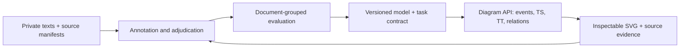

# TYM improvement roadmap

Prepared 19 October 2026. These are implementation plans, not newly measured results.

## The two prototypes

| Prototype | Reviewed implementation | Next outcome |
| --- | --- | --- |
| [Diagram API](diagram-api.md) | This .NET API, its React UI, and the newer research checkout's provenance/modeling documentation | Auditable event extraction and a consistent, inspectable TYM graph |
| [Corpus Explorer](corpus-explorer.md) | Separate `tym-corpus-app` research checkout, its .NET/ML.NET service, TypeScript workbench, benchmark reports, and integration evidence | Better annotation, independent evaluation, and a measured route from supplied mentions to document extraction |

The separate research checkouts were inspected under `Documents/ChatGPT/PhD`. This diagram checkout predates their provenance, modeling CLI, and workbench additions. Reconcile source history before porting those features; do not treat them as implemented here. The empty `TYM Learn API` workspace is not the corpus application's source tree.

## Delivery order

1. Freeze the source/example manifests, source-work groups, coordinate conventions, and task contracts shared by both prototypes.
2. Fix provenance, unknown ordering, source alignment, and export validation in the diagram API; retain the existing corpus workbench's equivalent protections.
3. Build and adjudicate a multi-work Romanian/English pilot, locking splits before training or synthetic augmentation.
4. Compare lexical baselines, richer non-LLM features, boundary detection, and directed relation candidates on the same held-out documents.
5. Connect reviewed corpus annotations and versioned models to the deterministic diagram renderer, then review UI and operations.

## Evidence rules

- Counts, software tests, prediction snapshots, and runtime are not semantic accuracy.
- Preserve the paper's historical CNN results separately from these ML.NET pipelines. No reproduction is claimed.
- TYM modes/relations and ISO-TimeML event/link tasks have separate inventories and evaluation units.
- Source-order adjacency does not establish story chronology. Unknown reference time, actor, perspective, or ordering remains explicit.
- Raw books and predictions are unlabeled. Clusters are exploratory; correction requires review and adjudication before gold status.
- Group translations, editions, and volumes of one work before splitting; keep synthetic descendants in the training partition of their parent.

## Example collection and pictures

See [the private example guide](examples.md). The supplied PDF and fifteen text files are complete local inputs. The Development diagram UI defaults to full text, loaded on demand, and offers a separate excerpt mode. Short request fixtures exercise the corpus workbench within its document-size limit; full-source fixtures are provided for the diagram API. Model labels and document dates are not invented.

Pictures are actual SVG diagrams produced by the current renderer and a local contact sheet, not decorative book covers or hand-labeled gold graphs. Their labels may expose extraction errors: preserve those observations as error-analysis material. The PDF page image is a local transcription check. Keep all book prose, derived SVGs, screenshots, and request fixtures outside Git and deployment bundles.

## Completion criteria

Each plan item names an observable acceptance condition. A release needs a task/schema version, a reproducible data/model identity, functional checks, and quality results whose scope is stated. No deadline or target accuracy is implied by priority. Implementation of the roadmaps is a separate work package from creating these plans and examples.

See [the delivery verification](verification.md) for observed import, preview, browser, privacy-boundary, and publishing checks.
